# ERMES Classes

This folder defines the domain classes used by ERMES as JSON class descriptors.
Each file describes a class name, optional parent classes, and static/dynamic
properties with type and constraint metadata.

Legend: `S:` = static property, `D:` = dynamic property. Inherited properties
are shown only in the class that declares them.

```mermaid
classDiagram
	class Patient {
		+S: name string
		+S: age int
		+S: height float
		+D: weight float
		+D: systolic_blood_pressure int
		+D: diastolic_blood_pressure int
		+D: heart_rate int
		+D: fallen bool
		+D: cognitive_performance float
	}

	class Caregiver {
		+S: name string
		+S: phone string
	}

	class Residence {
		+S: name string
		+S: city string
	}

	class Room {
		+S: name string
		+S: floor int
	}

	class Sensor {
		+S: name string
	}

	class Actuator {
		+S: name string
	}

	class StaticallyLocated {
		+S: x float
		+S: y float
	}

	class DynamicallyLocated {
		+S: lat float
		+S: lng float
	}

	class RoomLocated {
		+D: room Room
	}

	class SharedDevice {
		+D: patient Patient
	}

	class BloodPressureSensor {
		+D: systolic_blood_pressure int
		+D: diastolic_blood_pressure int
		+D: heart_rate int
	}

	class CognitiveExercise {
		+D: performance float
	}

	class FallDetector {
		+D: fallen bool
		+D: confidence float
	}

	class Locator {
		+D: room symbol
	}

	class rPPG {
		+D: HR int
		+D: BR int
		+D: SpO2 int
	}

	class SWF {
		+D: Fall int
		+D: HR int
		+D: Sms int
	}

	class Seremy {
		+S: seremy_id string
		+D: alarm symbol
		+D: alarm_source symbol
		+D: min_bpm int
		+D: max_bpm int
		+D: avg_bpm int
		+D: steps int
		+D: latitude float
		+D: longitude float
	}

	class Photosensor {
		+S: location symbol
		+S: enabled bool
		+D: lux float
		+D: cct int
		+D: status symbol
	}

	class LampDevice {
		+S: role symbol
		+S: max_flux float
		+S: calibration_k float
		+S: enabled bool
		+D: dimming float
		+D: cct int
	}

	class Alert {
		+S: channel string
		+D: subject string
		+D: level string
		+D: message string
	}

	Sensor <|-- BloodPressureSensor
	Sensor <|-- CognitiveExercise
	Sensor <|-- FallDetector
	Sensor <|-- Locator
	Sensor <|-- rPPG
	Sensor <|-- SWF
	Sensor <|-- Seremy
	Sensor <|-- Photosensor
	Sensor <|-- Alert

	Actuator <|-- LampDevice

	SharedDevice <|-- BloodPressureSensor
	SharedDevice <|-- CognitiveExercise
	SharedDevice <|-- FallDetector
	SharedDevice <|-- Locator
	SharedDevice <|-- rPPG
	SharedDevice <|-- SWF
	SharedDevice <|-- Seremy

	StaticallyLocated <|-- Photosensor
	StaticallyLocated <|-- LampDevice

	DynamicallyLocated <|-- Patient
	DynamicallyLocated <|-- SWF

	RoomLocated <|-- Patient

	SharedDevice --> Patient : patient
	RoomLocated --> Room : room
```

## From devices to patients

Every device given to a person is a `SharedDevice`: its `patient` property
points to the `Patient` currently using it. Devices only describe what they
measure; rules in [`../rules`](../rules) copy the values onto the patient with
`add-data`.

| Device class | Rule | Patient property |
|---|---|---|
| `BloodPressureSensor` | `blood-pressure-measurement` | `systolic_blood_pressure`, `diastolic_blood_pressure`, `heart_rate` |
| `CognitiveExercise` | `cognitive-performance` | `cognitive_performance` |
| `FallDetector` | `fall-event` | `fallen` |
| `Locator` | `patient-locator` | `room` (currently rejected, see notes) |
| `rPPG`, `SWF`, `Seremy` | none yet | - |

In rules, each class is a CLIPS template with an `id` slot, and each property
is a template named after the class that **declares** it, e.g.
`SharedDevice_patient` or `BloodPressureSensor_heart_rate` (not
`Patient_room`, since `room` is declared by `RoomLocated`).

## Notes

- Values must match the declared type exactly: an `int` is not accepted for a
  `float` property, and a `symbol` is not accepted for an `object` property.
  Since `add-data` turns CLIPS symbols into symbol values, a rule cannot set an
  `object` property such as `RoomLocated.room` from `Locator.room`.
- At startup, classes and rules are created only if no class or rule with the
  same name is stored yet, and objects only if their id is new. Editing an
  existing file does not change an already running deployment.
- Before pushing changes to `classes/`, `objects/` or `rules/`, run
  `python scripts/check_model.py` from the repository root.
